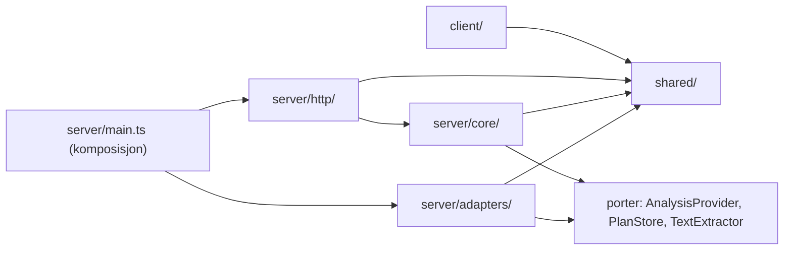
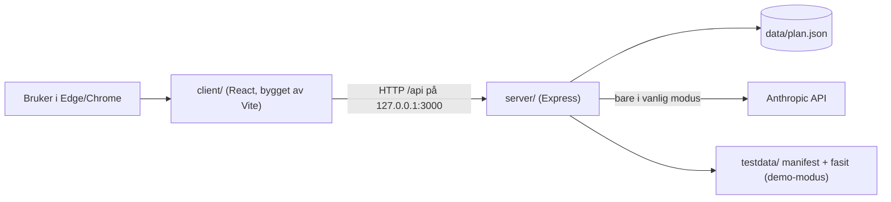

# Architecture Spine — Sambandet v1

> **Status:** utkast. `[ADOPTED]` betyr her godkjent av arkitekturansvarlig (Elias) 2026-11-22. Alle AD-er venter samlet gruppevedtak; når det foreligger, settes `status: final`. Begrunnelser og forkastede alternativer står i `.memlog.md`. PRD-en er styrende for krav; denne spinen avgjør bare hvordan de bygges.

## Design Paradigm

Lokal klient–server på én maskin. Nettleseren er presentasjon og midlertidig arbeidsflate; serveren eier alt som er hemmelig, varig eller må stoles på. Serverkjernen følger **ports and adapters**: kjernen (analyse-pipeline, regler, lagringslogikk) kjenner bare porter, og konkrete adaptere (Anthropic, demo, JSON-fil, tekstuttrekk) kan byttes uten at kjernen endres.

| Lag | Mappe | Ansvar |
| --- | --- | --- |
| Presentasjon | `client/` | Visninger F1–F8, validering mens brukeren skriver, aktiv gjennomgang i minnet |
| Delt domene | `shared/` | Kategoriliste, validering, skjemaer, normalisering, tegntelling, grenseverdier, feilkoder, dato-hjelpere |
| HTTP | `server/http/` | Express-ruter, parsing av kropper mot `shared/`-skjemaer, feilformat, Host-sjekk, statiske filer |
| Kjerne | `server/core/` | Analyse-pipeline, FR-17-behandling, FR-28-verifisering, lagringsoperasjoner |
| Adaptere | `server/adapters/` | `AnalysisProvider` (Anthropic, demo), `PlanStore` (JSON-fil), `TextExtractor` (.docx, PDF) |

## Invariants & Rules



Pilene viser lovlig avhengighet. `client/` importerer aldri fra `server/`. `server/core/` importerer aldri fra `server/adapters/` eller Express. Bare `server/main.ts` kobler porter til adaptere.

### AD-1 — Systemgrenser og API-nøkkel [ADOPTED]

- **Binds:** C-4, C-5, C-6, NFR-9, all
- **Prevents:** at nøkkelen havner i nettleseren eller i Git, og at andre maskiner eller fremmede nettsider når serveren
- **Rule:** Én lokal serverprosess lytter bare på `127.0.0.1`. Serveren avviser (403) alle kall der `Host` ikke er `127.0.0.1:PORT` eller `localhost:PORT`. API-nøkkel og modell leses bare av serveren fra miljøvariabler (`ANTHROPIC_API_KEY`, `ANTHROPIC_MODEL`). Nøkkelen sendes aldri til nettleseren, skrives aldri til logg og committes aldri; `.env.example` uten verdier committes.

### AD-2 — Gjennomgangen lever bare i nettleserens minne [ADOPTED]

- **Binds:** FR-21–FR-26, FR-29, NFR-1
- **Prevents:** at en gjennomgang overlever omlasting eller lagres halvveis, i strid med FR-26
- **Rule:** Aktivitetsforslag, feltstatus, kildeutdrag og midlertidige valg holdes bare i klientens tilstand på øverste nivå i appen, slik at de overlever navigasjon mellom F7 og F1 (ingen router som nullstiller tilstand). Serveren lagrer ingen gjennomgang. «Fullfør og lagre» sender alle godkjente forslag i ett kall, og serveren lagrer alle eller ingen. Er ingen forslag godkjent, avsluttes gjennomgangen i klienten uten kall. Knappen er sperret mens kallet pågår.

### AD-3 — Lagring: én JSON-fil bak én lagringsmodul [ADOPTED]

- **Binds:** FR-7, FR-4, FR-5, FR-26, NFR-1, NFR-2, NFR-4
- **Prevents:** halvveis lagret plan, tapte endringer ved overlappende kall, at flere moduler skriver til filen, og at en skadet fil overskrives
- **Rule:** All lesing og skriving går gjennom `PlanStore`. Alle endringer utføres én om gangen gjennom en kø i minnet (les → endre → skriv). Hver skriving går til en midlertidig fil med unikt navn i samme mappe og erstatter planfilen med rename; mappen opprettes ved behov, og rename forsøkes noen få ganger ved `EPERM`/`EBUSY`. Filen har `schemaVersion`. Mangler filen, er planen tom. Kan filen ikke leses eller parses, eller har den ukjent `schemaVersion`, svarer serveren med `STORE_CORRUPT` (melding med filsti og hva brukeren kan gjøre) og nekter alle skrivinger. Datamappen er gitignored.

### AD-4 — Aktivitetsmodellen [ADOPTED]

- **Binds:** FR-1–FR-7, FR-23, C-7
- **Prevents:** at KI-opprinnelse, kildeutdrag eller avledede verdier lagres, og at klient og server tolker felt ulikt
- **Rule:** En lagret aktivitet har nøyaktig feltene `id` (UUID laget av serveren), `tittel`, `ansvarsomrade`, `startdato`, `sluttdato`, `kategori`, `merknader` (alltid streng, tom streng når den er tom). ISO-uker, månedstall og hvilke år en aktivitet berører, beregnes ved visning og lagres aldri. Ukjent `id` ved endring eller sletting gir `NOT_FOUND`.

### AD-5 — Datoer er kalenderdatoer uten tid [ADOPTED]

- **Binds:** FR-2, FR-8–FR-11, FR-17
- **Prevents:** at en dato flytter seg én dag på grunn av tidssone eller sommertid, og at umulige datoer lagres
- **Rule:** Datoer lagres og sendes som strengen `ÅÅÅÅ-MM-DD`. En dato er gyldig bare hvis den er en ekte kalenderdato (2026-02-30 er ugyldig). Omregning skjer bare i dato-hjelperne i `shared/`, og «i dag» regnes i lokal tid. Visning som `dd.mm.åååå` er bare UI.

### AD-6 — `shared/` er eneste kilde for domeneregler [ADOPTED]

- **Binds:** FR-1, FR-2, FR-6, FR-12, FR-17, FR-28, C-3
- **Prevents:** at klient, server, KI-instruksjon og demo-fasit får ulike kategorier, regler eller grenser
- **Rule:** Kategorilisten (ni bokstavkoder fra EXPERIENCE.md: Ø, U, S, M, P, L, E, F, A, lagret som disse tegnene i UTF-8), validering, skjemaer, normalisering, tegntelling, grenseverdier (AD-12) og feilkoder defineres én gang i `shared/` og importeres overalt. KI-instruksjonene i `prompts/analyse/` er maler som fylles med kategorilisten fra `shared/` når appen kjører.

### AD-7 — Én valideringsfunksjon, serveren avgjør [ADOPTED]

- **Binds:** FR-2, FR-6, FR-22, FR-23, FR-26
- **Prevents:** at klient og server, eller manuelt skjema og gjennomgang, gir ulik feltstatus, og at ugyldige data lagres
- **Rule:** `valider()` i `shared/` er eneste kilde til status *manglende* og *ugyldig* for et felt. Klienten bruker den for umiddelbar tilbakemelding; serveren bruker den på hver skriving. Statusen KI satte, gjelder bare til brukeren har endret feltet. Er ett forslag i en fullføring ugyldig, avvises hele kallet med `VALIDATION_FAILED` og en liste over hvilke forslag og felt det gjelder.

### AD-8 — Analyse-pipeline på serveren [ADOPTED]

- **Binds:** FR-15–FR-20, FR-27–FR-30, NFR-2, NFR-3
- **Prevents:** at verifiseringen bruker en annen tekst enn modellen fikk, at feil type fil krasjer uttrekket, og at dokumentet blir liggende
- **Rule:** Ett analysekall går alltid gjennom, i denne rekkefølgen: filstørrelse (`FILE_TOO_LARGE`) → format ut fra filinnhold, `PK` for .docx og `%PDF` for PDF (`UNSUPPORTED_FORMAT`) → tekstuttrekk (feil gir `DOCUMENT_UNREADABLE`) → rensing → tom tekst (`NO_TEXT`) → tegngrense (`TEXT_TOO_LONG`) → `AnalysisProvider` (Anthropic eller demo) → strukturkontroll mot råskjemaet (AD-16) → FR-17-behandling med `valider()` → FR-28-verifisering av hvert kildeutdrag mot den samme teksten → svar. Dokument og tekst finnes bare i minnet under kallet og logges ikke. Serveren kjører bare én analyse om gangen (`ANALYSIS_BUSY`).

### AD-9 — Én språkmodell-leverandør bak én modul [ADOPTED]

- **Binds:** C-2, C-3, OQ-6, NFR-3, NFR-9
- **Prevents:** at leverandørkall spres i koden, skjulte ekstra kall, og at instruksjoner og dokumenttekst blandes
- **Rule:** Leverandøren er Anthropic (OQ-6; begrunnelse i memloggen: skjemastøttet strukturert svar, lav kostnad, samme verktøykjede som gruppen bruker). Bare `server/adapters/anthropic` kaller Anthropic. SDK-klienten opprettes med `maxRetries: 0`; kjernen gjør høyst ett nytt forsøk, og bare ved nettverksfeil, 429 eller 5xx, aldri ved 401/400 eller skjemafeil. Ett `AbortSignal` for hele fristen (AD-12) sendes med hvert kall. Modellen leses fra `ANTHROPIC_MODEL`; mangler den, feiler analysen med `MODEL_NOT_CONFIGURED`. Instruksjonene sendes som system-del; dokumentteksten sendes avgrenset som data. Bare dokumenttekst, kategorikontekst og instruksjoner sendes.

### AD-10 — Demo-modus aktiveres eksplisitt og meldes av serveren [ADOPTED]

- **Binds:** FR-18, FR-20, FR-30, C-5, OQ-7
- **Prevents:** stille eller automatisk demo-modus, og at klienten gjetter modus
- **Rule:** Demo-modus slås på ved oppstart med flagget `--demo`, eller `DEMO_MODE` lik `true` eller `1`, og er fast så lenge prosessen kjører. Modus skrives i terminalen ved oppstart. Serveren går aldri automatisk over til demo-modus. `GET /api/status` returnerer `demoMode`, og hvert analysesvar har også `demoMode`; klienten viser demo-merket bare ut fra disse. Uten nøkkel i vanlig modus starter appen normalt; manglende eller ugyldig nøkkel gir feilet analyse (FR-20). Demo-adapteren returnerer fasit i råskjemaet (AD-16), slik at demo går gjennom den samme behandlingen og verifiseringen som Anthropic.

### AD-11 — Testdokumenter gjenkjennes på innhold [ADOPTED]

- **Binds:** FR-18, FR-30, OQ-7, C-5
- **Prevents:** at et vilkårlig dokument får forhåndsdefinerte forslag, og at demo slutter å virke etter en bibliotekoppdatering
- **Rule:** Demo-adapteren slår opp SHA-256 av sammenligningsnøkkelen for teksten (se Tekstnormalisering) i et manifest som kobler hash til fasitfil. Bare eksakt treff gir forslag; filnavn brukes ikke. Ukjent dokument gir `DEMO_UNKNOWN_DOCUMENT` (FR-18). `npm test` regner ut hashen for hvert testdokument på nytt og sjekker den mot manifestet, og sjekker at alle kildeutdrag i fasiten verifiseres.

### AD-12 — Grenseverdier [ADOPTED]

- **Binds:** NFR-2, NFR-3, FR-6, NFR-8, OQ-8
- **Prevents:** ulike grenser i klient, server og tester
- **Rule:** Konstanter i `shared/`:
  - analysefrist 120 s totalt, inkludert nytt forsøk; klienten venter minst 130 s før den selv gir opp
  - `MAX_FILE_BYTES` = 10 × 1024 × 1024; bare større filer avvises; kontrolleres ved filvalg og på serveren
  - `MAX_TEXT_CHARS` = 100 000 kodepunkter i renset tekst
  - `MAX_NOTE_CHARS` = 5 000 kodepunkter, telt med `tellTegn()` etter at CRLF er gjort om til `\n`; HTML-attributtet `maxlength` brukes ikke, fordi det teller annerledes og kutter innlimt tekst (FR-6)
  - Express-grenser: rå opplasting = `MAX_FILE_BYTES` på analyseruten; JSON-kropper 1 MB
  - Nettlesere: siste Edge og Chrome støttes og testes; Firefox og Safari stikkprøves manuelt; dette står i README (NFR-8)

### AD-13 — Ubetrodd innhold vises som ren tekst [ADOPTED]

- **Binds:** NFR-9
- **Prevents:** at tekst fra dokument eller modell kjøres som kode
- **Rule:** Alt innhold fra dokumenter og modellsvar rendres som tekst i React. HTML-injeksjon (for eksempel `dangerouslySetInnerHTML`) brukes ikke.

### AD-14 — Testbarhet uten nøkkel [ADOPTED]

- **Binds:** NFR-10, SM-3, C-5
- **Prevents:** tester som krever nøkkel, nett eller den ekte planfilen, og at sensors vei brytes uten at noen merker det
- **Rule:** `npm test` kjører uten nøkkel og uten nett. Leverandør, frist og datasti (`DATA_FILE`) injiseres, slik at tester bruker falsk leverandør, kort frist og midlertidig mappe. KI-kvalitet og modellvalg måles bare i `npm run eval`, som kjøres manuelt. CI kjører typesjekk, test og `npm run build` på Node 24 og 26.

### AD-15 — Styling bygger på DESIGN.md-tokener, uten komponentbibliotek [ADOPTED]

- **Binds:** FR-8–FR-14, FR-21, NFR-7, NFR-8, C-8
- **Prevents:** at visninger får ulike farger, avstander og fokusstiler, og at et komponentbibliotek trekker inn et eget visuelt språk
- **Rule:** Fargene, typografien og avstandene i DESIGN.md-frontmatter defineres én gang som CSS custom properties i én global stilfil i `client/`. Komponenter bruker bare disse variablene, aldri egne fargekoder. Systemfontstabelen fra DESIGN.md brukes, uten webfont. Oransje brukes bare til tastaturfokus. Ingen komponent- eller UI-bibliotek legges til uten ny AD.

### AD-16 — To skjemaer for forslag: rått og behandlet [ADOPTED]

- **Binds:** FR-17, FR-18, FR-20, FR-27–FR-30
- **Prevents:** at demo-fasit og Anthropic-svar har ulik form, og at én feilaktig verdi forkaster hele analysen
- **Rule:** `shared/` har to zod-skjemaer. `RaattForslag` er det adapterne returnerer (verdi og KI-status `ok`/`usikker`/`manglende` per felt, kildeutdrag som liste av strenger, valgfri merknad); demo-fasit lagres i denne formen. Råskjemaet kontrollerer bare struktur og typer, ikke verdiregler. `Aktivitetsforslag` er det API-et returnerer, og bare kjernen lager det: verdiregler (kategori i listen, gyldig dato, datoregelen, merknadsgrensen) gir feltstatus via `valider()`, og hvert kildeutdrag får `verifisert`, `ikke verifisert` eller blir forkastet hvis det er tomt etter rensing. Strukturfeil, eller svar som er kuttet (`max_tokens`), gir `ANALYSIS_FAILED` (FR-20). En gyldig tom liste er et vellykket svar (FR-19). Merknader forkortes aldri.

### AD-17 — API-kropper defineres i `shared/api.ts` [ADOPTED]

- **Binds:** FR-1, FR-4, FR-23, FR-26, NFR-4
- **Prevents:** at skjema, gjennomgang og server sender og forventer ulike former, og at KI-felt lekker inn i lagringen
- **Rule:** Alle forespørsels- og svarformer er zod-skjemaer i `shared/api.ts`, brukt av både klient og server. `AktivitetInput` (uten `id`) avviser ukjente felt. Fullføring sendes som `{ aktiviteter: AktivitetInput[] }` og svarer med de lagrede aktivitetene. Feil svarer alltid som `{ code, message, details? }`, der `details` kan peke på forslag og felt.

## Consistency Conventions

| Concern | Convention |
| --- | --- |
| Språk i kode | Domenefelt følger PRD-ordlisten på norsk uten æøå (`tittel`, `ansvarsomrade`, `kildeutdrag`, `feltstatus`). Øvrige identifikatorer, filnavn og API-stier på engelsk. Brukertekst på norsk bokmål (C-8). |
| Feltstatus | `ok`, `usikker`, `manglende`, `ugyldig`. Modellen kan bare gi de tre første. |
| Behandlingsstatus | `ubehandlet`, `godkjent`, `avvist` (bare i klienten). |
| Feilkoder | Én liste i `shared/`: `FILE_TOO_LARGE`, `UNSUPPORTED_FORMAT`, `DOCUMENT_UNREADABLE`, `NO_TEXT`, `TEXT_TOO_LONG`, `DEMO_UNKNOWN_DOCUMENT`, `ANALYSIS_BUSY`, `ANALYSIS_TIMEOUT`, `ANALYSIS_FAILED`, `MODEL_NOT_CONFIGURED`, `VALIDATION_FAILED`, `NOT_FOUND`, `STORE_CORRUPT`, `STORE_WRITE_FAILED`. `message` er på norsk og sier hva brukeren kan gjøre (NFR-4). Bare `ANALYSIS_TIMEOUT`, `ANALYSIS_FAILED` og `MODEL_NOT_CONFIGURED` får setningen om demo-modus (FR-20). En global feilhåndterer gjør alle feil, også Express sine (for eksempel for stor kropp), om til dette formatet. |
| Tekstnormalisering | To funksjoner i `shared/`. `rensTekst`: Unicode NFC og CRLF/CR til `\n`; brukes på uttrukket tekst før grensesjekk og før teksten sendes til modellen, og på merknader. `sammenligningsnokkel`: `rensTekst` pluss alt hvitt rom (også U+00A0) slått sammen til ett mellomrom og trimmet; brukes av FR-28-verifisering og AD-11-hash. |
| Opplasting | Filen sendes som rå bytes. Filnavnet sendes `encodeURIComponent`-kodet i en egen header og brukes bare til visning; formatet avgjøres av filinnholdet. |
| Konfigurasjon | Bare miljøvariabler og CLI-flagg: `ANTHROPIC_API_KEY`, `ANTHROPIC_MODEL`, `DEMO_MODE` / `--demo`, `PORT` (standard 3000), `DATA_FILE` (standard `data/plan.json`). `npm start` og `npm run dev` laster `.env` med `--env-file-if-exists=.env`; `npm run demo` leser aldri `.env`. Opptatt port gir en norsk melding om `PORT`, ikke en stack trace. |
| TypeScript 7 | Én `tsconfig` med `"types": ["node"]` for serveren og DOM-typer for klienten; ingen `baseUrl`, ingen `moduleResolution: node`. Verktøy som trenger det gamle TypeScript-API-et (for eksempel ts-node og typescript-eslint) brukes ikke. |
| Statiske filer | I `start` og `demo` serverer Express den bygde klienten fra `client/dist`. `/api/*` kommer først, deretter filer, deretter SPA-fallback med Express 5-mønsteret `/{*splat}`. |
| Logging | `console` på serveren. Aldri nøkkel, dokumenttekst eller merknader i logg. |

## Stack

| Name | Version |
| --- | --- |
| Node.js | 24 eller 26 (LTS); `engines`: `^24.0.0 \|\| >=26.0.0` |
| TypeScript | 7.0.2 |
| React / react-dom | 19.3.1 |
| @types/react / @types/react-dom | 19.3.0 |
| Vite | 8.3.8 |
| @vitejs/plugin-react | 6.3.0 |
| Express | 5.3.0 |
| @types/express | 5.0.6 |
| @types/node | 24 |
| tsx | 4.23.15 |
| zod | 4.6.7 |
| @anthropic-ai/sdk | 1.12.0 |
| mammoth | 1.13.0 |
| unpdf | 2.2.1 |
| date-fns | 4.4.0 |
| Vitest | 5.1.1 |
| concurrently | 10.0.7 |
| Playwright (valgfritt, «bør») | versjon velges ved innføring |

Versjonene er kontrollert mot npm-registeret og prøveinstallert sammen på Node 24 den 2026-11-22. Eksakte versjoner låses av `package-lock.json`, som committes.

## Structural Seed



API-kontrakt (formene står i `shared/api.ts`, AD-17):

| Kall | Formål |
| --- | --- |
| `GET /api/status` | `demoMode` |
| `GET /api/activities` | Hele planen som liste, eller `STORE_CORRUPT` |
| `POST /api/activities` | Opprett aktivitet (FR-1) |
| `PUT /api/activities/:id` | Rediger aktivitet (FR-4) |
| `DELETE /api/activities/:id` | Slett aktivitet (FR-5) |
| `POST /api/analyze` | Analyser ett dokument, returner forslag og `demoMode` (FR-15–FR-20, FR-27–FR-30) |
| `POST /api/review/commit` | Lagre alle godkjente forslag atomisk (FR-26) |

```text
/
  client/            # React-app, visninger F1–F8, global stilfil med tokener
  server/
    main.ts          # komposisjon og oppstart (flagg, miljøvariabler)
    http/            # Express-ruter, feilhåndterer, Host-sjekk, statiske filer
    core/            # pipeline, regler, lagringsoperasjoner
    adapters/        # anthropic, demo, json-store, tekstuttrekk
  shared/            # kategorier, valider, skjemaer, api.ts, normalisering, grenser, feilkoder, dato
  prompts/
    analyse/         # versjonerte KI-instruksjoner (maler)
  testdata/          # fiktive testdokumenter (merket), manifest og fasit
  tests/             # Vitest enhet og integrasjon; e2e valgfritt
  data/              # planfil (gitignored)
  .github/workflows/ # CI: npm ci, typecheck, test, build på Node 24 og 26
```

Lokal kjøring og drift:

| Skript | Hva det gjør |
| --- | --- |
| `npm run demo` | Bygger klienten og starter serveren med `--demo` på `127.0.0.1:3000` (sensors vei, C-5) |
| `npm start` | Vanlig modus; leser `.env` hvis den finnes |
| `npm run dev` | Vite og server med automatisk omstart; Vite sender `/api` videre |
| `npm test` | Enhets- og integrasjonstester uten nøkkel |
| `npm run typecheck` | `tsc --noEmit` |
| `npm run build` | Bygger klienten |
| `npm run eval` | KI-kvalitet mot fasit (SM-3) og modellsammenligning; manuelt, med nøkkel |

Ingen hosting eller deploy i v1: appen kjøres bare lokalt (C-5, C-6). CI kjører på GitHub Actions uten hemmeligheter.

## Capability → Architecture Map

| Capability / Area | Lives in | Governed by |
| --- | --- | --- |
| Aktivitetshåndtering FR-1–FR-7 | `client/` skjema, `server/core` + `PlanStore` | AD-3, AD-4, AD-5, AD-6, AD-7, AD-17 |
| Årshjul og månedsvisning FR-8–FR-14 | `client/` (egen SVG), dato-hjelpere i `shared/` | AD-4, AD-5, AD-6, AD-15 |
| Opplasting og analyse FR-15–FR-20 | `server/core` pipeline, adaptere | AD-1, AD-8, AD-9, AD-12, AD-16 |
| Demo-modus FR-18, FR-30 | `server/adapters/demo`, `testdata/` | AD-10, AD-11, AD-16 |
| Gjennomgang og fullføring FR-21–FR-26 | `client/` tilstand, `POST /api/review/commit` | AD-2, AD-3, AD-7, AD-17 |
| Kildeutdrag FR-27–FR-29 | `server/core` verifisering, `client/` visning | AD-6, AD-8, AD-13, AD-16 |
| Pålitelighet NFR-1–NFR-3 | `PlanStore`, pipeline-frist | AD-3, AD-8, AD-9, AD-12 |
| Forståelige meldinger NFR-4 | feilkoder og `message` i `shared/` | AD-17, Feilkoder |
| Synlig fremdrift NFR-5 | `client/` ventetilstand under `POST /api/analyze` | AD-12 (klientens ventetid) |
| Responsiv navigasjon NFR-6 | `client/`: hele planen hentes én gang, visninger beregnes i klienten uten kall | AD-4, AD-5 |
| Tilgjengelighet og skjerm NFR-7, NFR-8 | `client/`, manuell sjekkliste, README | AD-12, AD-15 |
| Sikkerhet NFR-9, C-3, C-4 | server, adaptere, React-rendring | AD-1, AD-9, AD-13 |
| Testbarhet NFR-10, SM-3 | `tests/`, `npm run eval`, CI | AD-14 |
| Fiktive data C-1 | `testdata/` merket som fiktiv | AD-11, AD-14 |
| Lokal kjøring og enkeltbruker C-5, C-6 | skript, `127.0.0.1`, ingen innlogging | AD-1, AD-10, AD-14 |
| Dokumentinnhold og språk C-7, C-8 | pipeline i minnet; norsk brukertekst | AD-4, AD-8, Språk i kode |

## Deferred

- **Konkret modell** (`ANTHROPIC_MODEL`): velges etter `npm run eval` på 2–3 fiktive dokumenter. Kriterier: kvalitet mot fasit (SM-3), tregeste kjøring godt under 120 s, kostnad per analyse. Resultatet og valget føres i memloggen og README. Kan endres uten kodeendring.
- **Playwright-test av demo-flyten:** «bør», legges til hvis tiden tillater. Tastatur, fokus og projektor (NFR-7) kontrolleres med manuell sjekkliste.
- **Organisering av CSS per komponent** (for eksempel CSS Modules eller vanlige stilfiler): avgjøres i første UI-story innenfor AD-15.
- **Samtidige faner:** endringer serialiseres på serveren (AD-3), men en fane ser ikke andres endringer før den laster planen på nytt. Nevnes i README. Ingen låsing eller synkronisering i v1.
- **Dobbel innsending av fullføring etter tapt svar:** dekkes av sperret knapp (AD-2); ingen idempotensnøkkel i v1.
- **Flere brukere, innlogging, hosting, sikkerhetskopi:** utenfor v1 (C-6, PRD §7).
- **ESLint og formatering:** ikke påkrevd; typesjekk holder i v1.
- **Testplan med testmengder (OQ-9, OQ-10):** egen leveranse uten eier ennå; spinen gir bare rammen (AD-14).
