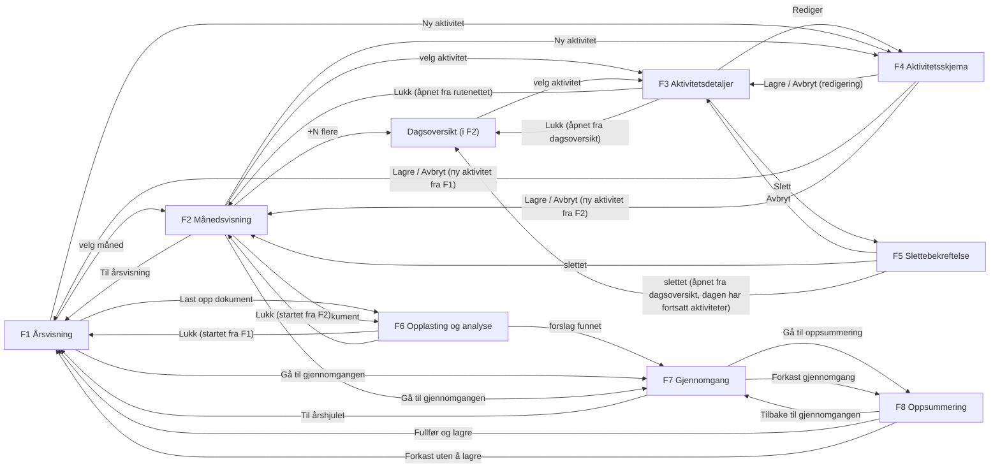

# KI-assistert interaktivt årshjul – EXPERIENCE.md (utkast)

> **Status: utkast (`status: draft`).** Kanoniske beslutninger står i `.memlog.md`; PRD-en styrer krav og begreper. OQ-3 ble avklart 2026-11-11. Dokumentet blir ikke `final` før OQ-7 er avklart og øvrige krav i workflowen er oppfylt; OQ-8 blokkerer ikke (gruppevedtak 2026-11-11, memlog).
>
> **Statusmarkører**
> - umerket = vedtatt (godkjent av Sebastian eller prosjektgruppen, bindende)
> - **[FORELØPIG]** = forslag, ikke godkjent
> - **[ÅPENT: …]** / **[AVHENGER AV: …]** = åpent spørsmål med eier
> - **[VALIDERES]** = må testes på PC, projektor, tastatur eller skjermleser; ikke testet ennå
>
> **Spinene vinner ved konflikt.** EXPERIENCE.md og DESIGN.md går foran wireframes i `wireframes/`, HTML-nøkkelmocker i `mockups/` og arbeidsfiler i `.working/`. Wireframene er lavdetaljerte gråtoneskisser med fiktive data og foreløpig ordlyd. PNG-forhåndsvisningene er laget med en lokal, omtrentlig renderer, ikke eksportert fra Excalidraw. Alle sju gjeldende `.excalidraw`-filer i `wireframes/` er åpnet i Excalidraw og bekreftet av Sebastian Byfuglien 2026-11-11 (memlog). Det er ikke en test på projektor, med tastatur eller skjermleser.
>
> **Prosjektstatus:** Den reviderte PRD-en (sist oppdatert 2026-11-11) er ikke validert på nytt etter BMAD-valideringen 2026-11-01. Valideringsfunnene gjelder teksten før revisjonen.

## Foundation

| Tema | Beslutning |
|---|---|
| Formfaktor | Lokal nettapplikasjon i nettleser på PC. Vises på storskjerm eller projektor i planleggingsmøter. Ingen mobiltilpasning (NFR-8). |
| Brukere | Én lokal bruker uten innlogging (C-6). Primærperson: Troppssjef Berg. |
| UI-system | Ikke bestemt. Ingen komponentbibliotek eller rammeverk er valgt; teknologivalg hører til arkitekturen. |
| Visuell identitet | `DESIGN.md` (tokener, komponentenes utseende, kontrast). Tokenreferanser her peker til DESIGN.md-frontmatter, f.eks. `{colors.focus}`. |
| Språk | Norsk bokmål i hele grensesnittet (C-8). PRD-ens Glossary brukes uten synonymer. |
| Produktnavn | «Årshjul (arbeidstittel)» inntil OQ-2 er avklart. |
| UX-prinsipp | Progressiv detaljering: År → Måned → Aktivitet. Jo nærmere brukeren går inn i planen, jo mer informasjon vises. Ingen egen uke- eller dagsvisning (PRD §7). |
| Lagringsmodell | Følger PRD: godkjente aktivitetsforslag lagres samlet først ved «Fullfør og lagre» (FR-26, NFR-1). |

## Kategoriliste og klassifisering

Gruppevedtak 2026-11-11, opplyst av Sebastian Byfuglien (OQ-3 avklart, memlog). Listen er fast; kategorier kan ikke opprettes eller endres i appen (FR-1, FR-2).

| Kode | Kategori |
|---|---|
| Ø | Øvelser og oppdrag |
| U | Utdanning og trening |
| S | Seremonier og oppstillinger |
| M | Møter og planlegging |
| P | Personell og velferd |
| L | Materiell og logistikk |
| E | Inspeksjon og evaluering |
| F | Frister |
| A | Annet |

**Klassifiseringsregler (vedtatt):**

1. Hver aktivitet har nøyaktig én kategori fra den faste listen.
2. Kategorien velges etter aktivitetens primære formål.
3. Rene leverings- og svarfrister, der fristen selv er aktiviteten, plasseres i «Frister». Arbeidet frem mot fristen kategoriseres etter sitt primære formål.
4. «Annet» brukes kun når aktiviteten er forståelig, men ingen annen kategori passer.
5. Både KI og bruker kan velge «Annet».
6. KI skal ikke bruke «Annet» automatisk ved manglende informasjon eller usikkerhet. Reglene for *manglende* og *usikker* etter FR-17 gjelder uendret.
7. Bokstavkodene er Ø, U, S, M, P, L, E, F og A.
8. Kategoriene skal kunne gjenkjennes uten farge (FR-12). Oransje er forbeholdt tastaturfokus.

**Kode og fullt navn i F1–F8** (innenfor vedtatte mønstre; Kategorimerke og Felt med etikett under Component Patterns):

| Flate | Bruk | Status |
|---|---|---|
| F1 Årsvisning | Per måned: antall + inntil to kategorimerker med kode og antall (f.eks. «Ø 8», «U 5») + eventuelt «+N øvrige aktiviteter». Alltid synlig, kompakt tegnforklaring med alle ni koder og fulle navn ved siden av hjulet. Tilgjengelig navn per måned gir hele fordelingen. | Vedtatt (gruppevedtak 2026-11-11, se Årshjulsirkel). Størrelse, plassering og lesbarhet **[VALIDERES]** på PC og projektor. |
| F2 Månedsvisning | Aktivitetsblokk: tittel + kode, f.eks. «Skyteøvelse [Ø]». Dagsoversikten viser per rad aktivitetstittel på første linje og datoer og kategorikode på neste, som i skissene (f.eks. «Førstehjelpskurs» / «18.03.2026 – 19.03.2026 · [U]»); vedtaket gjelder innholdet, ikke plasseringen. Fullt kategorinavn formidles i tilgjengelig tekst og vises i F3. | Vedtatt (dagsoversikt: gruppevedtak 2026-11-11). Skjermleser ikke testet. |
| F3 Aktivitetsdetaljer | Kategorifeltet viser kode og fullt navn: «Ø – Øvelser og oppdrag». | Vedtatt 2026-11-11. |
| F4 Aktivitetsskjema | Nedtrekksliste med de ni kategoriene, vist som «Ø – Øvelser og oppdrag». Ingen fritekst, ingen «opprett ny». | Vedtatt 2026-11-11 (FR-1, FR-2). |
| F5 Sletting | Ingen kategorivisning. | Uendret. |
| F6 Opplasting og analyse | Ingen kategorivisning. | Uendret. |
| F7 Gjennomgang | Kategorifeltet i aktivt forslag viser «Ø – Øvelser og oppdrag» og velges som i F4. *Manglende*: velg fra listen. *Usikker*: «? Kontroller:», kan godkjennes. «Annet» er en vanlig kategori, ikke en feltstatus (FR-17, UJ-1 E1a). | Vedtatt 2026-11-11. |
| F8 Oppsummering | Ingen kategorivisning. | Uendret. |

## Information Architecture

### Flater

F1–F8 er logiske flater, ikke nødvendigvis egne sider.

| Flate | Type | Nås fra | Formål | Krav |
|---|---|---|---|---|
| **F1 Årsvisning** | Hovedvisning | Oppstart; «Til årsvisning» i F2; etter fullføring/forkasting | Oversikt uten klikk: hvilke måneder har mye eller lite, og hva som preger periodene. Ingen aktivitetstitler. | FR-8, FR-9, FR-13, FR-14 |
| **F2 Månedsvisning** (inkl. dagsoversikt) | Hovedvisning | Velg måned i F1 | ISO-uker, alle aktiviteter i måneden, direkte navigasjon mellom måneder. Dagsoversikt via «+N flere». | FR-10, FR-11, FR-13, FR-14 |
| **F3 Aktivitetsdetaljer** | Modal over F2 | Aktivitet i F2 eller i dagsoversikten | Lesevisning av alle felt, med «Rediger», «Slett», «Lukk». | FR-3 |
| **F4 Aktivitetsskjema** | Modal | «Ny aktivitet» (F1/F2); «Rediger» i F3 (erstatter F3 i samme modal) | Opprette og redigere aktivitet. | FR-1, FR-2, FR-4, FR-6 |
| **F5 Slettebekreftelse** | Erstatter F3-innholdet i samme modal (én aktiv modal) | «Slett» i F3 | Bekrefte eller avbryte sletting. | FR-5 |
| **F6 Dokumentopplasting og analyse** | Modal over F1/F2 | «Last opp dokument» (F1/F2) | Velge fil, kjøre analyse, vise resultat eller feil. | FR-15–FR-20, NFR-2, NFR-3, NFR-5 |
| **F7 Gjennomgang** | Egen arbeidsflate | Analyse med forslag (F6); «Gå til gjennomgangen» (F1/F2) | Kontrollere, redigere, godkjenne eller avvise aktivitetsforslag mot kildeutdrag. | FR-21–FR-24, FR-27–FR-30 |
| **F8 Oppsummering, fullføring og forkasting** | Oppsummering + dialog | «Gå til oppsummering» / «Forkast gjennomgang» i F7 | Bekrefte «Fullfør og lagre», eller forkaste gjennomgangen. | FR-25, FR-26, NFR-1 |

Tverrgående: gjennomgangsindikator, meldingsstripe, demo-modus-merke.

### Navigasjonskart

### Inngangspunkter

- «Ny aktivitet» og «Last opp dokument» står i toppfeltet i både F1 og F2 (FR-1, FR-15).
- «Ny aktivitet» fra F2: datovelgeren åpner på måneden som vises, men ingen dato er forhåndsutfylt.
- Mens en gjennomgang er aktiv, er «Last opp dokument» synlig, men utilgjengelig, med synlig forklaring og vei tilbake til gjennomgangen (UJ-1 E8).

### Gjennomgangsindikator

Mens en gjennomgang er aktiv, vises en vedvarende stripe i både F1 og F2 med status (f.eks. antall forslag som gjenstår) og «Gå til gjennomgangen». Den vises bare mens gjennomgangen er aktiv, og forsvinner etter «Fullfør og lagre» eller «Forkast uten å lagre» (FR-26, UJ-1 E5).

### Returregler

| Etter | Brukeren havner i | Tilbakemelding |
|---|---|---|
| Lagret ny aktivitet (F4) | Visningen brukeren startet fra (F1 eller F2) | Meldingsstripe med tittel og dato. Ligger aktiviteten utenfor vist periode: datoene + lenke til riktig periode («Gå til januar 2027 →»). Ingen ekstra markering i kalenderen. Fokus til «Ny aktivitet» eller tilsvarende varig element. |
| Lagret redigering (F4) | F3 i samme modal, med oppdaterte verdier | «Endringene er lagret.» |
| Avbrutt skjema (F4) | Der skjemaet ble åpnet fra (visningen eller F3) | Ingen melding |
| Slettet aktivitet (F5), F3 åpnet fra rutenettet | Månedsvisningen (opprinnelig visning) | «‹Tittel› er slettet.» Fokus til varig element, f.eks. månedsoverskriften |
| Slettet aktivitet (F5), F3 åpnet fra dagsoversikt | Oppdatert dagsoversikt hvis dagen fortsatt har aktiviteter, ellers månedsvisningen | Som over; fokus til dagsoversiktens overskrift eller månedsoverskriften |
| «Lukk» i F3 åpnet fra rutenettet | Samme månedsvisning | Fokus tilbake til aktiviteten som åpnet modalen (gruppevedtak 2026-11-13) |
| «Lukk» i F3 åpnet fra dagsoversikt | Samme dagsoversikt i samme måned | – |
| Analyse med forslag (F6) | F7; gjennomgangen er aktiv | Se State Patterns › F6 «Forslag funnet» |
| «Lukk» i F6 | F1 eller F2, der opplastingen ble startet | Fokus tilbake til «Last opp dokument» (gruppevedtak 2026-11-13) |
| Feil, avvist fil eller ingen funn i F6 | Brukeren blir i den relevante F6-tilstanden til brukeren selv velger en tilgjengelig handling; ingen automatisk retur (gruppevedtak 2026-11-13) | Melding i dialogen, se State Patterns › F6 |
| «Fullfør og lagre» (F8) vellykket | F1 | Antall lagrede aktiviteter og hvilke kalenderår de gjelder |
| «Forkast uten å lagre» (F8) | F1, samme kalenderår som før gjennomgangen | «Gjennomgangen er forkastet. Ingen aktiviteter ble lagret.» Opplasting tilgjengelig igjen |
| «← Til årshjulet» i F7 | F1 | Gjennomgangen er fortsatt aktiv; indikatoren vises |
| «Til årsvisning» i F2 | F1 for kalenderåret til måneden som vises (FR-10) | – |

**Kalenderårregel etter «Fullfør og lagre»** (FR-9, FR-26):

1. Gjelder alle nye aktiviteter ett kalenderår → vis det året.
2. Gjelder de flere år → behold valgt år hvis det har nye aktiviteter; ellers vis året til aktiviteten med tidligste startdato.
3. Ble ingen forslag godkjent → behold valgt år, og si at ingen aktiviteter ble lagret.
4. En aktivitet «gjelder» hvert kalenderår den berører fra startdato til sluttdato (FR-11). Andre berørte år nås med vanlig årsnavigasjon.

### Flatelukking

Hvert UJ-steg har en flate, og hver flate har en brukerreise:

| Flate | UJ-1 | UJ-2 | UJ-3 |
|---|---|---|---|
| F1 | utgangspunkt, klimaks, E5, E8 | utgangspunkt, steg 1, klimaks | steg 1, 2, 5, klimaks, E3, E4 |
| F2 (inkl. dagsoversikt) | E5 (indikator) | steg 2, 3 | steg 3, E1–E4 |
| F3 | – | steg 2, 3 | steg 4 |
| F4 | – | steg 1, 2, E1, E2, E4 | (steg 4 videre til UJ-2) |
| F5 | – | steg 3, E3 | – |
| F6 | steg 1, 2, E2, E3, E7, E8 | – | – |
| F7 | steg 3, E1, E1a, E4, E5, E6, E6a, E9 | – | – |
| F8 | steg 4, klimaks, E8, E9, E10, E11 | – | – |

## Voice and Tone

Vedtatt regel (C-8, NFR-4): klar, profesjonell bokmål. Hver melding sier **hva som skjedde**, **hvorfor noe er sperret** (når det er det) og **hva brukeren kan gjøre**. PRD-ens Glossary brukes konsekvent (aktivitet, aktivitetsforslag, gjennomgang, kildeutdrag, feltstatus, fullføring, forkasting av gjennomgang, demo-modus). Ingen tekniske feilkoder som eneste informasjon.

Faste formuleringer (vedtatt):

| Situasjon | Tekst |
|---|---|
| Blokkerende feltstatus | «! Må rettes:» + årsak |
| Ikke-blokkerende feltstatus | «? Kontroller:» + årsak |
| Kildeutdrag | «Verifisert» / «Ikke verifisert», alltid med forklaring. Aldri «korrekt» eller «bekreftet». |
| Handlinger | «Gå til oppsummering», «Fullfør og lagre», «Forkast gjennomgang», «Fortsett gjennomgangen», «Forkast uten å lagre», «Prøv igjen», «Lukk», «Godkjenn», «Avvis», «Rediger», «Slett», «Avbryt», «Ny aktivitet», «Last opp dokument», «Gå til gjennomgangen» |
| Påminnelse i F6 | «Bruk bare fiktive dokumenter – ikke last opp ekte dokumenter fra Forsvaret.» (fast og obligatorisk) |

Eksempler fra wireframene, språkvasket og godkjent (gruppevedtak 2026-11-13): fire formuleringer er endret, og de øvrige er godkjent uendret. Tallene i eksemplene (f.eks. «120» og «8 forslag») er fiktive; tegngrensen er ikke fastsatt (OQ-8). Unntak: setningen om demo-modus i eksemplet om feilet analyse avventer OQ-7.

| Gjør | Ikke gjør |
|---|---|
| «Kan ikke godkjennes ennå: Sluttdato og Ansvarsområde må rettes.» | «Ugyldig skjema» |
| «! Må rettes: Ugyldig – sluttdato er før startdato» | «Feil i dato» |
| «! Må rettes: Ugyldig – 120 tegn for mye. Kort ned teksten eller fjern merknaden. Teksten forkortes ikke automatisk.» | Stille forkorting av merknaden |
| «? Kontroller: Usikker – sammenlign med kildeutdraget» | «Advarsel!» |
| «Verifisert – Teksten finnes i dokumentet. Det betyr ikke at forslaget er riktig.» | «Bekreftet av kilden» |
| «Ikke verifisert – Teksten ble ikke funnet i dokumentet. Kontroller forslaget selv.» | «Kilde OK?» |
| «Kan ikke gå til oppsummering ennå: 8 forslag er ikke behandlet. 1 godkjent forslag har felt som må rettes.» | Grå knapp uten forklaring |
| «Opplasting er sperret mens en gjennomgang pågår. Fullfør eller forkast gjennomgangen først.» | Verktøytips som eneste forklaring |
| «Lagringen mislyktes. Ingen aktiviteter er lagret. Valgene dine er beholdt. Prøv igjen.» | «Feil 500» |
| «Appen kontrollerer ikke om aktivitetene allerede finnes i planen. Mulige duplikater må du sjekke selv.» | Å antyde duplikatkontroll |
| «Analysen kunne ikke gjennomføres. Språkmodellen svarte ikke eller ga et ugyldig svar. Planen er uendret. Demo-modus finnes for støttede testdokumenter.» Setningen om demo-modus **[AVHENGER AV: OQ-7 – arkitektur]** | Automatisk overgang til demo-modus |
| «Dokumentet kan ikke leses. Skannede PDF-er og bilder støttes ikke. Bruk .docx eller tekstbasert PDF.» | «Ugyldig fil» |
| «Fant ingen aktiviteter i «Notat_FIKTIV.docx». Planen er uendret.» | Tom gjennomgang |
| «Slette aktiviteten? «Koordineringsmøte» (18.03.2026) fjernes fra planen. Slettingen kan ikke angres.» | «Er du sikker?» |
| «Forkaste gjennomgangen? Forslagene og endringene du har gjort i gjennomgangen, går tapt. Ingen nye aktiviteter lagres.» | – |
| «Forkaste endringene? Endringene du har gjort, blir ikke lagret.» | – |

Ingen plassholder som «[tidsgrense]» vises i grensesnittet. Melding ved for stor fil (vedtatt 2026-11-09): «Dokumentet er for stort til å behandles. Velg et mindre dokument.» Selve grensen **[AVHENGER AV: OQ-8 – arkitektur]**.

## Component Patterns

Atferd. Utseende står i DESIGN.md › Components med samme navn.

| Komponent | Bruk | Atferdsregler |
|---|---|---|
| **Primærknapp** | Hovedhandling per flate | Én per flate. I bekreftelsesdialoger er det trygge valget fremhevet og standard («Avbryt» i F5, «Fortsett gjennomgangen» i F8, «Fortsett redigeringen» i F4). I F6 ved feil er «Prøv igjen» primær. |
| **Sekundærknapp** | Øvrige handlinger | «Last opp dokument», «Avvis», «Lukk», «Gå til gjennomgangen» m.fl. I dialoger står det trygge standardvalget først/til venstre og den destruktive handlingen til høyre (vedtatt 2026-11-09). |
| **Tekstlenke** | Navigasjon i tekst | Brukes i meldinger, f.eks. lenke til riktig periode etter lagring utenfor vist periode. Pil bare når lenken bytter flate. |
| **Deaktivert kontroll med årsak** | «Godkjenn», «Gå til oppsummering», «Last opp dokument» under aktiv gjennomgang, «Analyser dokumentet» før fil er valgt | Kontrollen er synlig, men utilgjengelig. Årsaken står som synlig tekst ved kontrollen og er knyttet til den for skjermleser – aldri hover eller farge alene. Årsaken oppdateres når et felt forlates eller endres. Ingen generell regel om at utilgjengelige kontroller skal kunne få fokus. Per komponent velges vanlig `disabled` eller `aria-disabled`; brukes `aria-disabled`, må aktivering faktisk hindres. Forklaringen må uansett være tilgjengelig med tastatur og skjermleser (vedtatt 2026-11-09) **[VALIDERES]**. |
| **Panel** | Gruppering | Ingen egen atferd. |
| **Fokusring** | Alle interaktive elementer | Vises bare ved tastaturfokus (`:focus-visible`), ikke ved museklikk. Ingen andre betydninger. |
| **Valgt/aktiv-markering** | Valgt måned i F1, valgt kalenderår i F1, aktivt forslag i F7 | Skilles fra fokus og fra blokkerende feil. Bæres av tekst («Valgt: Mars 2026», «Aktiv»). I F1 markeres sist besøkte måned nøytralt når brukeren kommer tilbake fra F2 (vedtatt 2026-11-09). Valgt kalenderår i årvelgeren i F1 bruker samme nøytrale markering i begge F1-tilstander, tydelig forskjellig fra primærknappen «Ny aktivitet» (gruppevedtak 2026-11-12, alternativ B; ingen nye navigasjonsregler eller komponenter). I kalenderårvelgeren er årstallet (f.eks. «2026») sammen med den nøytrale markeringen og `aria-current` tilstrekkelig; ordet «Valgt:» kreves ikke der. Presiseringen gjelder bare denne velgeren, ikke andre komponenter (gruppevedtak 2026-11-13). Aldri oransje. |
| **Felt med etikett** | F4, aktivt forslag i F7 | Synlig etikett over feltet. «(obligatorisk)» som tekst. Kategori er nedtrekksliste med bare kategorilisten (de ni vedtatte kategoriene) – ingen fritekst, ingen «opprett ny» (FR-1, FR-2). Datoer i formatet dd.mm.åååå, med både tastaturinntasting og datovelger (vedtatt 2026-11-09). Merknader har tegnteller **[AVHENGER AV: OQ-8 – arkitektur]** for grensen. Formulering i den godkjente F4-mocken (2026-11-13): «0 tegn» for tom merknad og «N tegn over grensen» når merknaden er for lang. Telleren fastsetter ingen grense; tallene i mockene er fiktive. |
| **Feltstatusmelding** | Under felt i F4 og F7 | «Må rettes» (manglende/ugyldig) blokkerer lagring og godkjenning; «Kontroller» (usikker) blokkerer ikke. Status står direkte ved feltet, uten hover. KI-status vises straks; brukerendrede felt valideres når feltet forlates og ved lagring. Avhengige felt vurderes på nytt (f.eks. forsvinner «ugyldig sluttdato» når startdatoen rettes). Når brukeren har endret et felt, gjelder ikke lenger KI-statusen (FR-22). Fritekst med bare mellomrom = manglende (FR-2). |
| **Feiloppsummering** | F4 ved «Lagre» med feil; aktivt forslag i F7 | Lister feltene som må rettes. I F4 flyttes fokus til første relevante feil. Hvert felt i oppsummeringen er en lenke som flytter fokus til feltet (vedtatt 2026-11-09). |
| **Kildeutdragskort** | F7 | Ett kort per kildeutdrag, vist samtidig med forslagets felt (FR-27). Status per utdrag (FR-28). Tomt utdrag eller bare mellomrom/linjeskift = mangler, ikke verifisert. Mangler/ikke verifisert blokkerer ikke godkjenning (FR-29). Ren tekst (NFR-9). Ingen dokumentviser eller navigasjon i dokumentet (§4.5). |
| **Kategorimerke** | F1, F2, F3, F7 | Viser kategori som bokstavkode (og antall i F1). Samme identitet i F1 og F2 og mellom økter (FR-12). Koder: Ø, U, S, M, P, L, E, F, A – se Kategoriliste og klassifisering (gruppevedtak 2026-11-11). |
| **Modal/dialog** | F3–F5 (én modal som bytter innhold), F6, forkastingsdialogen i F8 (over F7) | **Én aktiv modal om gangen** (vedtatt 2026-11-09). F4 og F5 erstatter F3-innholdet i samme modal; «Avbryt» i F5 viser F3 igjen med samme aktivitet. «Forkaste endringene?» vises inne i samme modal. Ingen stablede modaler eller konkurrerende fokusfeller. Fokus holdes inne. Esc = trygt valg (unntak: under analyse i F6 gjør Esc ingenting). Fokus tilbake til elementet som åpnet modalen. Dagsoversikten er ikke en modal (se Dagsoversikt). Ved åpning av skjema får «Tittel» (F4) eller «Velg fil» (F6) innledende fokus (vedtatt 2026-11-09). I dialoger står det trygge standardvalget først/til venstre, destruktiv handling til høyre. |
| **Gjennomgangsindikator** | F1, F2 under aktiv gjennomgang | Vedvarende, ikke lukkbar. Viser antall forslag som gjenstår. «Gå til gjennomgangen» åpner F7 med uendrede valg. Endringer annonseres via aria-live. |
| **Meldingsstripe** | Bekreftelser og feil i F1/F2 | Full bredde under toppfeltet, annonseres via aria-live. Fokus flyttes ikke til meldingen. Forsvinner ikke automatisk, heller ikke ved neste brukerhandling. Blir stående til brukeren lukker den («Lukk») eller meldingen ikke lenger er relevant (vedtatt 2026-11-09). |
| **Periodenavigasjon** | F1 kalenderår, F2 måned | Kalenderår uten fast grense (FR-9). Månedsnavigasjon går over årsskiftet til tilstøtende kalenderår (FR-10). Valgt kalenderår i F1 har valgt/aktiv-markering; oransje brukes bare til tastaturfokus (gruppevedtak 2026-11-12). |
| **Årshjulsirkel** | F1 | Ett tabulatorstopp. Piltaster flytter fokus mellom måneder uten å åpne eller bytte visning; Home/End til januar/desember; Enter/Space åpner F2 for måneden i fokus. Klikk på en måned åpner F2 direkte, uten mellomsteg. Månedstall = antall unike aktiviteter som berører måneden (FR-8, FR-11); summen kan være større enn antall aktiviteter, og dette forklares i visningen. Aktiviteter kan ikke åpnes direkte fra hjulet; veien går via F2 (FR-3, vedtatt tolkning). Kategorifordeling (gruppevedtak 2026-11-11): inntil to kategorimerker med kode og antall for de to største kategoriene, sortert etter antall og ved likt antall Ø, U, S, M, P, L, E, F, A; «+N øvrige aktiviteter» når andre kategorier også har aktiviteter (N = antall aktiviteter), slik at merketallene + N = månedens antall; ingen merker eller restindikator ved 0. Månedens tilgjengelige navn gir hele fordelingen, f.eks. «Mars 2026, 20 aktiviteter: U 4, M 4, Ø 3, F 3, P 2, L 2, E 2» (skjermleser ikke testet). |
| **Månedsrutenett** | F2 | Viser alle ISO-uker som berører måneden, men bare aktiviteter som faktisk berører kalendermåneden (M6-1). Maks to aktivitetsblokker per dag; «+N flere» er en knapp som åpner dagsoversikten. Flerukesaktiviteter har fortsettelsesmerking i hver ukerad, er én aktivitet og telles én gang. |
| **Dagsoversikt** | F2 | Utvidbar liste i månedsvisningen, **ikke en modal** (vedtatt 2026-11-09). «+N flere» åpner listen; den viser alle aktiviteter den dagen. F3 kan åpnes som modal fra listen; når F3 lukkes, er brukeren tilbake i samme dagsoversikt og måned. Ingen egen modal fokusfelle. Esc eller «Lukk» lukker listen med fokus tilbake til «+N flere». Ikke en dagsvisning med tidsluker (PRD §7). Hver rad viser tittel, datoer og kategorikode; tilgjengelig tekst gir fullt kategorinavn (gruppevedtak 2026-11-11). |
| **Forslagsoversikt** | F7 | Synlig som standard; kan skjules og åpnes igjen («Vis alle forslag (15)»). Viser behandlingsstatus og problemmerker hver for seg, også «? Usikker». Velg et forslag for å gjøre det aktivt. Piltaster innenfor listen. Valget om å skjule oversikten huskes i den aktive gjennomgangen, ikke på tvers av gjennomganger (vedtatt 2026-11-09). |
| **Demo-modus-merke** | Alle flater i demo-modus | Står fast så lenge appen kjører i demo-modus (FR-18). Hvordan demo-modus aktiveres **[AVHENGER AV: OQ-7 – arkitektur]**. |
| **Fremdriftsindikator** | F6 under analyse | Ubestemt; statusteksten annonseres via aria-live. Ingen avbryt-knapp. |

## State Patterns

Statiske illustrasjoner (spinene vinner ved konflikt): F1 årshjulet og gjennomgang aktiv ([`mockups/key-f1-arsvisning.html`](mockups/key-f1-arsvisning.html)) · F2 måned og dagsoversikt ([`mockups/key-f2-manedsvisning.html`](mockups/key-f2-manedsvisning.html)) · F4 tomt skjema og lagring stoppet ([`mockups/key-f4-aktivitetsskjema.html`](mockups/key-f4-aktivitetsskjema.html)) · F7 aktivt forslag med blokkerende feil og fullføring sperret ([`mockups/key-f7-gjennomgang.html`](mockups/key-f7-gjennomgang.html)).

| Flate | Tilstand | Behandling |
|---|---|---|
| F1 | Tomt kalenderår | Hjulet beholder 12 måneder med «0», og meldingen «Ingen aktiviteter er lagt inn i 2027» (FR-14, UJ-3 E3). |
| F1 | Tom måned | Sektoren viser «0 – Ingen aktiviteter». |
| F1 | Mange aktiviteter i én måned | Bare antall, inntil to kategorimerker og eventuelt «+N øvrige aktiviteter»; lesbart med 20 aktiviteter (FR-13, UJ-3 E4) **[VALIDERES]**. |
| F1 | Gjennomgang aktiv | Gjennomgangsindikator; «Last opp dokument» utilgjengelig med synlig forklaring. Hjulet viser bare lagrede aktiviteter (UJ-1 E5). |
| F1 | Etter fullføring/forkasting | Meldingsstripe (se Returregler). |
| F1 | Retur fra F2 | Sist besøkte måned er nøytralt markert, f.eks. «Valgt: Mars 2026». Aldri oransje (vedtatt 2026-11-09). |
| F1/F2 | Oppstart | Inneværende kalenderår (FR-9). Oppstart uten API-nøkkel **[AVHENGER AV: OQ-7 – arkitektur]**. |
| F2 | Tom måned | Rutenettet vises; tydelig melding om at ingen aktiviteter er lagt inn. Etter M6-1 teller ikke aktiviteter som bare ligger i nabomånedens dager (FR-14). |
| F2 | Uker over årsskifte | Riktige ISO-ukenumre, f.eks. uke 1 i desember, uke 53 (UJ-3 E2). |
| F2 | Flerdagsaktivitet over måneds- eller årsskifte | Vises i alle måneder og uker den berører; én aktivitet (UJ-3 E1). |
| F2 | Mer enn to aktiviteter én dag | «+N flere» → dagsoversikt. |
| F3 | Lesevisning | Alle felt med lagrede verdier; merknader med bevart avsnittsinndeling (FR-3, FR-6). Ingen KI-opprinnelse eller kildeutdrag. |
| F3 | Sletting feilet | Feilen vises i slettebekreftelsen (F5) i samme modal, se F5. |
| F4 | Tomt skjema | Ingen dato forhåndsutfylt; «Tittel» får innledende fokus (vedtatt 2026-11-09). |
| F4 | Lagring stoppet | «Lagre» kan alltid aktiveres. Feiloppsummering + feltstatusmeldinger; fokus til første relevante feil (FR-2, UJ-2 E1/E2). |
| F4 | Merknad over grensen | Status *ugyldig*; antall tegn som må fjernes (ordlyd i teller og melding: se Felt med etikett og Voice and Tone); lagring sperret; aldri automatisk forkorting; brukeren korter ned eller fjerner selv. Tom merknad er gyldig. Samme regel for KI-merknader i F7 (godkjenning og fullføring sperret), og hele KI-merknaden bevares. Grensen **[AVHENGER AV: OQ-8 – arkitektur]** (M11-a, gruppevedtak 2026-11-11; FR-2, FR-6, FR-22, FR-23). |
| F4 | Lagringsfeil | Skjemaet blir stående med brukerens verdier; «Lagringen mislyktes. Ingen endringer er lagret. Prøv igjen.» Ingen melding om vellykket lagring (NFR-1, FR-4). Meldingen vises øverst i modalen, med tilgjengelig fokushåndtering (vedtatt 2026-11-09). |
| F4 | Ulagrede endringer ved Avbryt/Esc | «Forkaste endringene?» i samme modal; «Fortsett redigeringen» er trygt standardvalg. Uten endringer lukkes skjemaet direkte (F4-4). |
| F5 | Bekreftelse | Erstatter F3-innholdet i samme modal (én aktiv modal). «Avbryt» er trygt, fremhevet standardvalg og viser F3 igjen med samme aktivitet; Esc = Avbryt (UJ-2 E3). |
| F5 | Sletting feilet | Aktiviteten og slettedialogen beholdes. Feilen vises tydelig og annonseres til skjermleser. «Prøv igjen» er primærhandling, «Avbryt» er tilgjengelig. Ingen automatisk gjentakelse. I den opprinnelige bekreftelsen er «Avbryt» fortsatt det trygge, fremhevede standardvalget (FR-5, NFR-1, NFR-4) (vedtatt 2026-11-09). |
| F5 | Slettet | Meldingsstripe annonseres via aria-live; fokus til varig element, ikke til meldingen. Antall i F1 oppdateres. |
| F6 | Velg fil | Påminnelse om fiktive dokumenter; «Dokumentet brukes bare til analysen og lagres ikke.» (FR-16). «Analyser dokumentet» utilgjengelig til fil er valgt. «Velg fil» får innledende fokus (vedtatt 2026-11-09). Dra-og-slipp inngår ikke i v1. |
| F6 | Feil format eller for stor fil | Kontrolleres ved filvalg; melding i dialogen, ingen forslag, planen uendret (FR-15, NFR-2). For stor fil: «Dokumentet er for stort til å behandles. Velg et mindre dokument.» (vedtatt 2026-11-09). Størrelsesgrense **[AVHENGER AV: OQ-8 – arkitektur]**. |
| F6 | Skannet PDF | Avvises etter at analysen har startet og tekstinnholdet er kontrollert (UJ-1 E2). |
| F6 | Analyse pågår | Fremdriftsindikator + «Dette kan ta litt tid. Analysen avsluttes automatisk hvis den ikke gir svar.» Modalen kan ikke lukkes; Esc gjør ingenting; ingen avbryt-funksjon (NFR-5, F6-4). |
| F6 | Tidsgrense nådd | Behandles som feilet analyse med «Prøv igjen» (primær) og «Lukk» (NFR-3, FR-20). Tidsgrensen **[AVHENGER AV: OQ-8 – arkitektur]**. |
| F6 | Analyse feilet / ugyldig svar | Forståelig melding + informasjon om demo-modus; ingen automatisk overgang; ingen forslag vises; ingen gjennomgang blir aktiv (FR-20, UJ-1 E7). |
| F6 | Ingen aktiviteter funnet | «Fant ingen aktiviteter … Planen er uendret.» Ingen gjennomgang blir aktiv (FR-19, UJ-1 E3). |
| F6 | Demo-modus | Demo-modus-merke; støttet testdokument gir forhåndsdefinerte forslag. Dokument som ikke støttes: tydelig melding, ingen forslag, planen uendret (FR-18). |
| F6 | Forslag funnet | Gjennomgangen blir aktiv; F7 åpnes. |
| F7 | Aktivt forslag | Felt og kildeutdrag samtidig; teller «Godkjent · Avvist · Ubehandlet» alltid synlig (FR-21, E9). |
| F7 | Blokkerende feil i forslaget | «Godkjenn» utilgjengelig med synlig liste over felt og årsak (FR-23, UJ-1 E1, E1a). «Avvis» er tilgjengelig. |
| F7 | Usikkert felt | «? Kontroller:»; kan godkjennes uendret. Vises også i forslagsoversikten. |
| F7 | Ingen eller ikke verifiserte kildeutdrag | Kildeutdragskort «Mangler»/«Ikke verifisert»; blokkerer ikke (UJ-1 E4). |
| F7 | Etter Godkjenn/Avvis | Tydelig tilbakemelding; automatisk videre til neste ubehandlede forslag. Godkjenning endrer ikke planen. Valg kan omgjøres til «Fullfør og lagre». |
| F7 | Alle behandlet | Samlet status; «Gå til oppsummering» blir tilgjengelig hvis ingen godkjente forslag har blokkerende feil. |
| F7 | Fullføring sperret | «Gå til oppsummering» utilgjengelig med årsak (ubehandlede forslag, godkjent forslag med manglende/ugyldig felt, inkl. M11-a) (UJ-1 E9). |
| F7 | Demo-modus | Demo-modus-merke; ellers identisk flyt (FR-18). |
| F7 | Økten avsluttes | Lukking, krasj eller omlasting før fullføring: gjennomgangen er tapt, ingen aktiviteter lagret (UJ-1 E5). |
| F8 | Oppsummering | Antall som lagres og forkastes, berørte kalenderår, påminnelse om at duplikater ikke kontrolleres (UJ-1 E11). |
| F8 | Alle avvist | «0 aktiviteter lagres»; etter fullføring: ingen aktiviteter ble lagret, samme kalenderår beholdes. |
| F8 | Lagringsfeil | Brukeren blir i oppsummeringen; «Lagringen mislyktes. Ingen aktiviteter er lagret. Valgene dine er beholdt. Prøv igjen.» Ingen delvis lagring vist som vellykket (UJ-1 E10, NFR-1). |
| F8 | Forkasting | Dialog «Forkaste gjennomgangen?»; «Fortsett gjennomgangen» trygt, fremhevet standardvalg; «Forkast uten å lagre» tilgjengelig. Avvisning av enkeltforslag krever ingen bekreftelse. |
| Alle | Fokus | Fokusring bare ved tastatur (DESIGN.md `{colors.focus}`). |
| Alle | Valgt/aktiv | Nøytral markering + tekst; aldri oransje. |
| Alle | Deaktivert | Alltid med synlig årsak. |

## Interaction Primitives

- **År ↔ måned:** direkte visningsbytte uten zoomanimasjon, med tydelig overskrift og riktig tastaturfokus (FR-10, NFR-7).
- **Månedsnavigasjon:** ◀/▶ til forrige/neste måned, også over årsskiftet. «Til årsvisning» gir kalenderåret til måneden som vises.
- **Kalenderår:** ◀/▶ i F1, ingen fast grense (FR-9).
- **«+N flere»:** knapp i dagcellen; åpner dagsoversikten i F2.
- **Modaler:** én aktiv modal om gangen. F4 og F5 erstatter F3-innholdet i samme modal; bekreftelse av ulagrede endringer vises inne i samme modal. Ingen stablede modaler eller konkurrerende fokusfeller.
- **Validering:** ved forlatt felt og ved «Lagre»; avhengige felt vurderes på nytt. I F7 er «Godkjenn» utilgjengelig så lenge blokkerende feil finnes, så validering «ved godkjenningsforsøk» gjelder ikke.
- **Rekkefølge i F7:** første til siste som standard; brukeren kan velge et hvilket som helst forslag. Ingen sortering eller filtrering (FR-21). Ingen «godkjenn alle» (FR-23).
- **Automatisk videregang i F7:** etter Godkjenn/Avvis → neste ubehandlede forslag.
- **Bekreftelser med trygt standardvalg:** F4-4 («Fortsett redigeringen»), F5 («Avbryt»), F8 («Fortsett gjennomgangen»).
- **Esc:** lukker dagsoversikt, F3 og dialoger med trygt valg. I F4 med ulagrede endringer åpner Esc bekreftelsen. Under analyse i F6 gjør Esc ingenting.
- **Ikke del av designet:** dra-og-slipp (inngår ikke i v1 – vedtatt 2026-11-09), nye hurtigtaster, avbryt-knapp under analyse, angrefunksjon for sletting (FR-5), flere samtidige analyser (FR-15).

## Accessibility Floor

Atferd. Kontrast står i DESIGN.md. Grunnlaget er NFR-7 (tastatur, synlig fokus, kontrast etter WCAG 2.1 1.4.3, tydelige etiketter, feil i tekst); full WCAG 2.1 AA kreves ikke i v1. **Alt i denne seksjonen er [VALIDERES]** – ikke testet med tastatur, skjermleser eller projektor ennå.

**Tastaturmodell (vedtatt)**

| Flate | Regel |
|---|---|
| Alle | Tabulatorrekkefølge: toppfelt (kalenderår/periode, «Ny aktivitet», «Last opp dokument») → gjennomgangsindikator → hovedinnhold. Ingen nye hurtigtaster. |
| F1 | Hjulet er ett tabulatorstopp. Piltaster flytter fokus mellom måneder uten å åpne eller bytte visning. Home/End = januar/desember. Enter/Space åpner F2. Skjermleser leser f.eks. «Mars 2026, 20 aktiviteter». |
| F2 | Tab til månedsnavigasjonen, deretter aktivitetene i datorekkefølge. «+N flere» er en knapp. Esc lukker dagsoversikt/F3. |
| F7 | Tab mellom forslagsoversikt, felt, kildeutdrag og handlinger; piltaster i oversikten. |
| Modaler | Fokus holdes inne; fokus tilbake til elementet som åpnet modalen. Ved åpning får «Tittel» (F4) eller «Velg fil» (F6) innledende fokus (vedtatt 2026-11-09). |

**Fokusretur**

- F3 lukket fra rutenettet → aktiviteten som åpnet modalen, i samme månedsvisning (gruppevedtak 2026-11-13).
- F3 lukket fra dagsoversikt → dagsoversikten beholdes i samme måned.
- Dagsoversikt lukket med Esc eller «Lukk» → fokus tilbake til «+N flere» som åpnet den (følger regelen om fokusretur).
- Etter oppretting → «Ny aktivitet» eller tilsvarende varig element.
- Etter redigering → F3 i samme modal; ved Avbryt uten endringer → «Rediger».
- Etter sletting → varig element i gjenværende visning (dagsoversiktens overskrift eller månedsoverskriften), ikke meldingen.
- F5 avbrutt → «Slett».
- F6 lukket → «Last opp dokument» i F1 eller F2, der opplastingen ble startet (gruppevedtak 2026-11-13).

**Annonsering (aria-live):** meldingsstripe, gjennomgangsindikator, statustekst under analyse, resultat av analyse, slettebekreftelse.

**Øvrig:** synlige etiketter over alle felt; obligatorisk merket med tekst; alle feil og årsaker i tekst ved elementet, aldri bare farge, ikon eller hover; status og kategori kan forstås i gråtoner (FR-12); klikkmål ≥ 44 px; fokusring bare ved tastaturfokus; kildeutdrag og merknader som ren tekst (NFR-9).

## Key Flows

### UJ-1. Troppssjef Berg gjør en ny ordre om til aktiviteter i årshjulet

*Berg har fått en fiktiv ordre om øvelser, utdanning og frister og vil ha dem inn i planen før neste planleggingsmøte uten å skrive dem inn manuelt.*

1. Berg åpner appen og ser **F1** for inneværende kalenderår.
2. Berg velger «Last opp dokument» → **F6**. Dialogen minner om at bare fiktive dokumenter skal brukes. Berg velger `Ordre_vinter_FIKTIV.docx` og «Analyser dokumentet».
3. **F6** viser ubestemt fremdrift. Analysen gir 15 aktivitetsforslag → **F7** åpnes, gjennomgangen er aktiv.
4. I **F7** går Berg gjennom forslagene ett for ett med kildeutdragene ved siden av: godkjenner et komplett forslag, fyller inn manglende ansvarsområde, retter en sluttdato som er før startdato, kontrollerer en usikker kategori og godkjenner den uendret, korter ned en lang merknad og fjerner en annen, og avviser et forslag som ikke gjelder troppen. Etter hvert valg går appen videre til neste ubehandlede forslag.
5. Midt i arbeidet går Berg «← Til årshjulet» (**F1**) for å sjekke mars. Gjennomgangsindikatoren viser «8 av 15 forslag gjenstår». «Gå til gjennomgangen» fører tilbake med alle valg intakt.
6. Alle forslag er behandlet. Berg velger «Gå til oppsummering» → **F8**: «9 aktiviteter lagres · 6 forslag forkastes · Gjelder kalenderår: 2026 og 2027» og påminnelsen om duplikater.
7. **Klimaks:** Berg velger «Fullfør og lagre». Appen viser **F1** med meldingen «9 aktiviteter er lagret. De gjelder 2026 og 2027.» Antallene i månedene har økt der ordren hører hjemme. Ordren er blitt plan uten gjeninntasting, og hvert forslag er kontrollert mot kildeutdragene.

Feilveier:

| Feilvei | Flate | Tilstand |
|---|---|---|
| E1 obligatorisk felt manglende/ugyldig | F7 | «Godkjenn» utilgjengelig med felt og årsak |
| E1a kategori manglende/usikker | F7 | Manglende: velg fra kategorilisten. Usikker: «? Kontroller:», kan godkjennes |
| E2 skannet PDF, bilde, feil format | F6 | Avvist med melding; ingen forslag |
| E3 ingen aktiviteter funnet | F6 | Melding; planen uendret; ingen gjennomgang |
| E4 kildeutdrag mangler / ikke verifisert | F7 | Kildeutdragskort «Mangler»/«Ikke verifisert»; blokkerer ikke |
| E5 til årshjulet og tilbake; økten avsluttes | F1, F7 | Indikator; valg beholdes. Tapt ved lukking/krasj/omlasting |
| E6, E6a sluttdato/dato uten grunnlag | F7 | Feltstatus manglende («! Må rettes») eller usikker («? Kontroller») |
| E7 språkmodell utilgjengelig / ugyldig svar / tidsgrense | F6 | «Prøv igjen»/«Lukk»; info om demo-modus; ingen automatisk overgang |
| E8 ny opplasting under aktiv gjennomgang | F1, F2 | «Last opp dokument» utilgjengelig med forklaring; opplasting blir tilgjengelig igjen etter fullføring eller forkasting i F8 |
| E9 ubehandlede forslag ved fullføring | F7 | «Gå til oppsummering» utilgjengelig med årsak |
| E10 lagringsfeil ved fullføring | F8 | Ingen aktiviteter lagret; valg beholdt; prøv igjen |
| E11 mulige duplikater | F8 | Påminnelse om at appen ikke kontrollerer duplikater |

Forkasting: «Forkast gjennomgang» → dialog → «Forkast uten å lagre» → **F1** i samme kalenderår, «Gjennomgangen er forkastet. Ingen aktiviteter ble lagret.»

### UJ-2. Troppssjef Berg oppretter, flytter og sletter aktiviteter manuelt

*Etter et koordineringsmøte har Berg tre endringer som ikke står i noe dokument.*

1. I **F1** velger Berg «Ny aktivitet» → **F4**. Berg fyller inn en todagers skyteøvelse, velger kategori fra kategorilisten, skriver ansvarsområde og merknader, og velger «Lagre». Berg kommer tilbake til **F1** med «Aktiviteten «Skyteøvelse» er lagret (24.03.2026–25.03.2026).», og antallet i måneden har økt.
2. Berg velger måneden i hjulet → **F2**, finner utdanningsaktiviteten og åpner den → **F3**. «Rediger» gjør modalen om til **F4**. Berg flytter datoene én uke, legger til en merknad og lagrer → **F3** i samme modal med «Endringene er lagret.»
3. Berg åpner den avlyste aktiviteten (**F3**, via dagsoversikten fordi dagen har mange aktiviteter) og velger «Slett» → **F5**: «Slette aktiviteten? … Slettingen kan ikke angres.» Berg velger «Slett aktiviteten».
4. **Klimaks:** Berg er tilbake i den oppdaterte dagsoversikten med «‹Tittel› er slettet.» Årshjulet viser planen slik den faktisk er etter møtet, uten Excel.

Feilveier:

| Feilvei | Flate | Tilstand |
|---|---|---|
| E1 obligatorisk felt mangler | F4 | Feiloppsummering + «! Må rettes»; fokus til første feil |
| E2 sluttdato før startdato | F4 | «! Må rettes: Ugyldig – sluttdato er før startdato» |
| E3 avbryter sletting | F5 → F3 | Aktiviteten uendret; ingen melding |
| E4 éndagsaktivitet | F4 | Lik start- og sluttdato lagres |
| Lagrings-/slettefeil | F4, F5 | Melding i modalen/dialogen; aktiviteten uendret (NFR-1) |
| Ny aktivitet utenfor vist periode | F1/F2 | Datoer + lenke til riktig periode |

### UJ-3. Troppssjef Berg bruker årshjulet til å forberede og gjennomføre et planleggingsmøte

*Berg sitter ved PC-en koblet til projektoren. Årshjulet er møtets felles bilde.*

1. **F1** viser 2026: antall aktiviteter per måned og hvilke kategorier som preger periodene. Troppsledelsen ser uten klikk at mars er travel (20) og juli tom.
2. Berg bytter til 2027 for å sjekke en øvelse i januar, og tilbake til 2026.
3. Noen spør «Hva skjer i mars?». Berg velger mars → **F2** med ISO-uker 9–14 og alle 20 aktivitetene. Deretter ◀/▶ direkte til april.
4. Berg åpner en aktivitet → **F3**: tittel, datoer, kategori, ansvarsområde og merknader.
5. Berg velger «Til årsvisning» → **F1** for kalenderåret til måneden som vises, med sist besøkte måned nøytralt markert («Valgt: April 2026»).
6. **Klimaks:** Spørsmål om når noe skjer og hvem som har ansvaret, besvares med noen få klikk på skjermen, uten leting i Excel-ark eller ordre.

Feilveier:

| Feilvei | Flate | Tilstand |
|---|---|---|
| E1 aktivitet over måneds- eller årsskifte | F1, F2 | Telles i alle berørte måneder og år; fortsettelsesmerking; én aktivitet |
| E2 ISO-uker ved årsskifte | F2 | Riktig ukenummer (uke 1 / uke 53) |
| E3 tom måned eller tomt kalenderår | F1, F2 | Tom tilstand med tydelig melding |
| E4 mange aktiviteter i samme måned | F1, F2 | F1 sammenfatter med antall; F2 viser maks to per dag + «+N flere» → dagsoversikt |

## Responsive & Platform

| Plattform | Atferd |
|---|---|
| PC (nettleser) | Primær. Utformet for ca. 1920 × 1080. Tastatur og mus. |
| Projektor/storskjerm | Samme visning som PC; ingen egen presentasjonsmodus. Lesbarhet av tekststørrelser, kontrast, fokusring og kategorimerker på ekte projektor er ikke testet **[VALIDERES]**. |
| Mobil/nettbrett | Ikke støttet i v1 (NFR-8). |
| Nettlesere | Dokumenteres i README når teknologivalg er gjort **[AVHENGER AV: OQ-8 – arkitektur]**. |

## Inspiration & Anti-patterns

- **Hentet fra Apple:** luft, tydelig hierarki, én primærhandling per flate.
- **Hentet fra Polestar:** presis struktur, hårlinjer, nøktern layout.
- **Hentet fra Langsikt:** metadata og redaksjonelt hierarki (dato · kategori · tittel).
- Bare inspirasjon: ingen kopiering av nettsteder, logoer, bilder eller eksakt design.
- **Avvist – Excel-arbeidet:** tette visninger, oppsplittet informasjon, unødvendig navigasjon og flere dokumenter for å få oversikt.
- **Avvist – zoomanimasjon mellom år og måned:** direkte visningsbytte i stedet.
- **Avvist – aktivitetstitler i hjulet** (OQ-4 alternativ B–D): F1 sammenfatter per måned.
- **Avvist – sidepanel for F3:** modal valgt.
- **Avvist – «godkjenn alle»** (FR-23) og **automatisk overgang til demo-modus** (FR-20).

## Visuelle referanser

**Mockdekning (gruppevedtak 2026-11-13):** F1, F2, F4 og F7 har HTML-mock, wireframe og spine. F3, F5, F6 og F8 har ingen egne HTML-mocker, men dekkes av gjeldende Excalidraw-skisser i `wireframes/` og beskrivelsene i DESIGN.md og EXPERIENCE.md. Vedtaket gjelder dokumentasjonsdekningen i UX-leveransen; ingen flate utelates fra implementasjonen.

| Fil | Viser |
|---|---|
| [`mockups/key-f1-arsvisning.html`](mockups/key-f1-arsvisning.html) | F1 HTML-nøkkelmock (statisk): A årshjulet 2026, B gjennomgang pågår med sperret opplasting |
| [`mockups/key-f2-manedsvisning.html`](mockups/key-f2-manedsvisning.html) | F2 HTML-nøkkelmock (statisk): A mars 2026 med «+N flere», B ikke-modal dagsoversikt 18. mars |
| [`mockups/key-f4-aktivitetsskjema.html`](mockups/key-f4-aktivitetsskjema.html) | F4 HTML-nøkkelmock (statisk): A tomt skjema med innfelt datovelger og kategoriliste, B lagring stoppet med fire feltfeil |
| [`mockups/key-f7-gjennomgang.html`](mockups/key-f7-gjennomgang.html) | F7 HTML-nøkkelmock (statisk): A oversikt synlig, B oversikt skjult; blokkerende feil, usikker kategori, kildeutdrag med status, utilgjengelig «Godkjenn» og «Gå til oppsummering» med årsak |
| [`wireframes/flow-f1-arsvisning-2026-11-03.forhandsvisning.png`](wireframes/flow-f1-arsvisning-2026-11-03.forhandsvisning.png) ([kilde](wireframes/flow-f1-arsvisning-2026-11-03.excalidraw)) | F1: hovedtilstand, gjennomgang pågår med sperret opplasting, tomt kalenderår |
| [`wireframes/flow-f2-f3-manedsvisning-v3-2026-11-03.forhandsvisning.png`](wireframes/flow-f2-f3-manedsvisning-v3-2026-11-03.forhandsvisning.png) ([kilde](wireframes/flow-f2-f3-manedsvisning-v3-2026-11-03.excalidraw)) | F2 mars 2026 (M6-1, «+N flere», fortsettelsesmerking), dagsoversikt, F3 som modal; D sidepanel er IKKE VALGT |
| [`wireframes/flow-f4-aktivitetsskjema-2026-11-09.forhandsvisning.png`](wireframes/flow-f4-aktivitetsskjema-2026-11-09.forhandsvisning.png) ([kilde](wireframes/flow-f4-aktivitetsskjema-2026-11-09.excalidraw)) | F4: tomt skjema, lagring stoppet med feiloppsummering, lagret + utenfor periode, redigering i samme modal, lagringsfeil, avbryt med/uten endringer |
| [`wireframes/flow-f5-sletting-2026-11-09.forhandsvisning.png`](wireframes/flow-f5-sletting-2026-11-09.forhandsvisning.png) ([kilde](wireframes/flow-f5-sletting-2026-11-09.excalidraw)) | F5: bekreftelse, avbrutt, slettet fra månedsvisning og fra dagsoversikt, slettefeil |
| [`wireframes/flow-f6-opplasting-analyse-2026-11-09.forhandsvisning.png`](wireframes/flow-f6-opplasting-analyse-2026-11-09.forhandsvisning.png) ([kilde](wireframes/flow-f6-opplasting-analyse-2026-11-09.excalidraw)) | F6: velg fil, avvisning, analyse pågår, forslag → F7, ingen funnet, feilet, demo-modus, opplasting sperret |
| [`wireframes/flow-f7-gjennomgang-v3-2026-11-03.forhandsvisning.png`](wireframes/flow-f7-gjennomgang-v3-2026-11-03.forhandsvisning.png) ([kilde](wireframes/flow-f7-gjennomgang-v3-2026-11-03.excalidraw)) | F7: oversikt synlig/skjult, aktivt forslag med feltstatus, kildeutdrag, utilgjengelig «Godkjenn» og «Gå til oppsummering» med årsak |
| [`wireframes/flow-f8-oppsummering-forkasting-2026-11-03.forhandsvisning.png`](wireframes/flow-f8-oppsummering-forkasting-2026-11-03.forhandsvisning.png) ([kilde](wireframes/flow-f8-oppsummering-forkasting-2026-11-03.excalidraw)) | F8: oppsummering, vellykket lagring, lagringsfeil, forkasting. Oppdatert 2026-11-09: «Fortsett gjennomgangen» er fremhevet standardvalg i forkastingsdialogen. |
| [`.working/kombinert-retning-1.html`](.working/kombinert-retning-1.html) | Historisk arbeidsfil som kan brukes som referanse for palett og formspråk (se DESIGN.md). Viser utdaterte kategoriplassholdere («Kat. A–I») og er ikke styrende for gjeldende kategorier eller funksjonelle UX-regler. |

Historikk, ikke gjeldende: tidligere F1/F2/F7-versjoner (`flow-f2-manedsvisning-2026-11-03`, `flow-f2-f3-manedsvisning-v2-…`, `flow-f7-gjennomgang-2026-11-03`, `flow-f7-gjennomgang-v2-…`), `direction-1/2/3-*.html` og `color-themes-lys-1.html`. Alle filene ligger fortsatt i `.working/`; de er ikke flyttet til `wireframes/` eller `mockups/`.

## Åpne spørsmål, avhengigheter og validering

### Åpne

| Punkt | Status | Eier | Kilde | Påvirker |
|---|---|---|---|---|
| Klassifiseringstest: 25–30 fiktive aktiviteter kategorisert hver for seg av gruppens medlemmer | [VALIDERES] – ikke gjennomført | Gruppen | memlog 2026-11-02 | Kategoriliste og klassifisering |
| OQ-7 Hvordan demo-modus aktiveres, hvordan støttede testdokumenter gjenkjennes, oppstart uten API-nøkkel. **Blokkerer `status: final`** (gruppevedtak 2026-11-11): aktivering og oppstart kan påvirke UX-flyten. Ingen teknisk løsning er valgt. | [AVHENGER AV] – åpen, blokkerer final | Arkitektur | PRD §10.4; memlog 2026-11-11 | Demo-modus-merke, F6 |
| OQ-8 Tidsgrense for analyse, tegngrense for merknader, maks dokumentstørrelse, nettlesere. **Blokkerer ikke Finalize** (gruppevedtak 2026-11-11): eksakte verdier fastsettes i arkitekturen; gjeldende regler for validering, feilmeldinger og ugyldige merknader beholdes; endrer arkitekturen brukerflyten, oppdateres UX. | [AVHENGER AV] – åpen, ikke-blokkerende | Arkitektur | PRD §10.4, FR-6, NFR-2, NFR-3; memlog 2026-11-11 | F4 tegnteller, F6 meldinger |
| OQ-2 Endelig produktnavn | [ÅPENT] | Gruppen | PRD §10.2 | Toppfelt |
| Størrelse, plassering og lesbarhet av kategorimerker, restindikator og tegnforklaring i F1 på PC og projektor | [VALIDERES] – ikke gjennomført | Gruppen | memlog 2026-11-11 | Årshjulsirkel |
| Visuelle detaljer fra skissene (demping bak modal, rammer og kanter, demo-modus-merke, fremdriftsindikator) er utgangspunkt, ikke validert | [VALIDERES] | Gruppen | memlog 2026-11-09 | DESIGN.md › Components |
| Valg av `disabled` eller `aria-disabled` per komponent, og at forklaringen nås med tastatur og skjermleser | [VALIDERES] | Gruppen | memlog 2026-11-09 | Deaktivert kontroll med årsak |
| Lesbarhet (tekststørrelser, kontrast, kategorimerker) på vanlig PC og ekte projektor | [VALIDERES] | Gruppen | memlog 2026-11-09 | DESIGN.md |
| Fokusringens synlighet på projektor (særlig mot deaktivert flate, ~3,0:1) | [VALIDERES] | Gruppen | kombinert-retning-1 | Fokusring |
| Tastaturflyt og skjermleseropplesning | [VALIDERES] | Gruppen | memlog 2026-11-09 | Accessibility Floor |
| Valgt-markering vs. «Må rettes»-ramme kan forveksles (begge mørk kant) | [VALIDERES] | Gruppen | kombinert-retning-1 | Valgt/aktiv-markering, Feltstatusmelding |
| Gjeldende wireframes F1–F8 er oppdatert med vedtatte kategorikoder 2026-11-11 (F6 hadde ingen kategorier). `kombinert-retning-1.html` og historiske skisser viser fortsatt plassholderne «Kat. A–I». Gjeldende koder står i Kategoriliste og klassifisering. | Dokumentert avvik | Sebastian | memlog 2026-11-11 | Visuelle referanser |
| Revidert PRD ikke validert på nytt etter 2026-11-01 | Dokumentert prosjektstatus | Gruppen | KI-logg 2026-11-01; memlog | Alle |
| Ordlyd om demo-modus: merket «DEMO-MODUS – forhåndsdefinerte forslag, ingen språkmodell» og setningen «Demo-modus finnes for støttede testdokumenter.» i meldingen om feilet analyse | [FORELØPIG] / [AVHENGER AV: OQ-7] | Gruppen | memlog 2026-11-09, 2026-11-13 | Demo-modus-merke, F6 |
| Øvrig mikrotekst fra skissene som ikke står i eksemplene i Voice and Tone og ikke er merket vedtatt, er ikke språkvasket samlet | [FORELØPIG] | Sebastian | memlog 2026-11-09 | Alle |

### Avklart

| Punkt | Status | Eier | Kilde | Påvirker |
|---|---|---|---|---|
| OQ-3 Kategoriliste – **avklart 2026-11-11** (gruppevedtak opplyst av Sebastian Byfuglien): ni kategorier med koder Ø, U, S, M, P, L, E, F, A, inkl. «Frister» og restkategorien «Annet», og klassifisering etter primært formål. Se Kategoriliste og klassifisering. PRD §10.3 og FR-17/UJ-1 E1a presisert 2026-11-11. | Vedtatt | Gruppen | PRD §10.3; memlog 2026-11-02/03, 2026-11-11 | Kategorimerke, F4 kategoriliste, F7 |
| M11-a – **avklart 2026-11-11** (gruppevedtak opplyst av Sebastian Byfuglien, alternativ A): utfylt merknad over tegngrensen er *ugyldig* og blokkerer lagring, godkjenning og fullføring; aldri automatisk forkorting; gjelder bruker- og KI-merknader. PRD presisert 2026-11-11 (FR-2, FR-6, FR-22, FR-23, Glossary Feltstatus, OQ-8). | Vedtatt | Gruppen | memlog 2026-11-03, 2026-11-11 | F4, F7, E9 |
| Når valgt måned vises i F1 – **løst 2026-11-09:** sist besøkte måned markeres nøytralt ved retur fra F2 | Vedtatt | Sebastian | memlog 2026-11-09 | Valgt/aktiv-markering, Årshjulsirkel |
| Kategorifordelingens visualisering i hjulet (OQ-4-detalj) – **avklart 2026-11-11** (gruppevedtak opplyst av Sebastian Byfuglien): inntil to kategorimerker, «+N øvrige aktiviteter», tegnforklaring ved siden av hjulet. Se Årshjulsirkel. | Vedtatt | Gruppen | memlog 2026-11-03, 2026-11-11 | Årshjulsirkel, Kategorimerke |
| Kategorivisning i dagsoversikten – **avklart 2026-11-11** (gruppevedtak opplyst av Sebastian Byfuglien): tittel og kategorikode; fullt navn i tilgjengelig tekst og i F3. Kategorifarger brukes ikke uten eget vedtak. | Vedtatt | Gruppen | memlog 2026-11-11 | Dagsoversikt, Kategorimerke |
| De 13 foreløpige detaljene (innledende fokus, lagringsfeil i F4, meldingsstripe, lenker i feiloppsummering, knapperekkefølge, valgt/aktiv 2 px, melding om for stor fil, ingen dra-og-slipp, mikrotekst, datoformat, utilgjengelige kontroller, skjult oversikt, visuelle detaljer) samt dagsoversikt og feil ved sletting – **løst 2026-11-09** | Vedtatt | Sebastian | memlog 2026-11-09 | Flere komponenter |
| F5 over F3 – **løst 2026-11-09:** én aktiv modal; F5 erstatter F3-innholdet i samme modal | Vedtatt | Sebastian | memlog 2026-11-09; F5-wireframe | Modal/dialog |
| Åpning i Excalidraw: bekreftet av Sebastian Byfuglien 2026-11-11 for alle sju gjeldende skisser (F1, F2/F3, F4, F5, F6, F7, F8). Forhåndsvisningene er visuelt gjennomgått. Dette er ikke projektor-, tastatur- eller skjermlesertesting (egne rader). | Bekreftet (åpning) | Gruppen | memlog 2026-11-03/09 | Visuelle referanser |
| UX-tolkninger registrert uten PRD-endring: M6-1 (månedsvisningens innhold), tomt kildeutdrag = mangler (FR-27/FR-28), FR-3 via månedsvisningen. Gruppen kan vurdere å presisere PRD-en. | Vedtatt i UX | Gruppen | memlog 2026-11-03 | F2, F7, F1 |
| Eksemplene i Voice and Tone – **avklart 2026-11-13** (gruppevedtak bekreftet av Sebastian Byfuglien på vegne av prosjektgruppen): fire formuleringer er språkvasket (for lang merknad, usikker kategori, sperret oppsummering, feil ved lagring), og de øvrige eksemplene er godkjent uendret. Demo-modus-teksten er unntatt (se Åpne). | Vedtatt | Gruppen | memlog 2026-11-09, 2026-11-13 | Voice and Tone, F4, F7, F8 |
